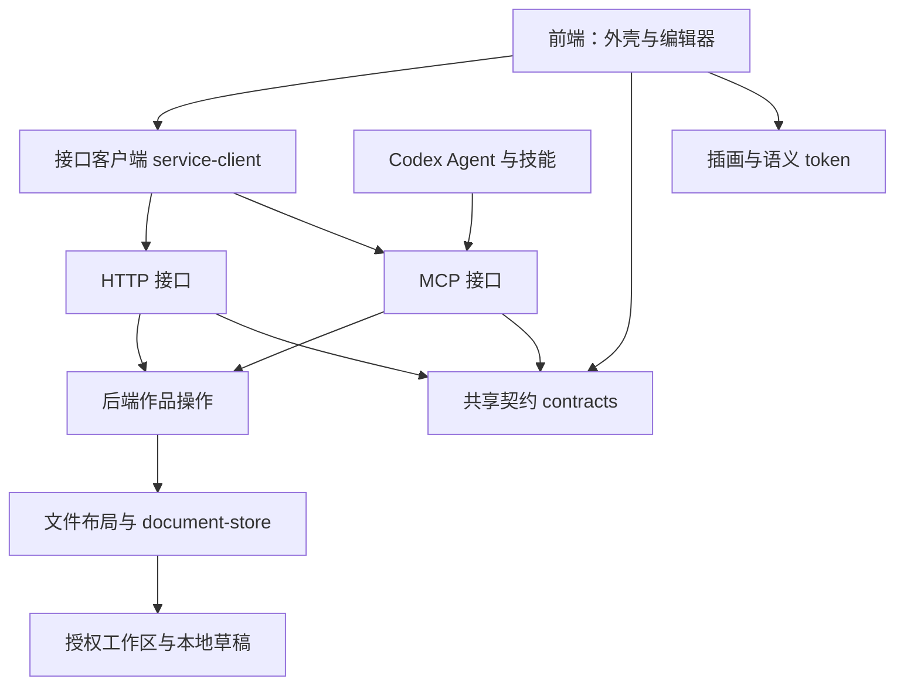

# MineDesign 架构与文件路由

本文维护模块职责、依赖与运行契约。功能用途见 [CONTEXT.md](CONTEXT.md)，视觉约定见 [DESIGN.md](DESIGN.md)，开发流程见 [docs/development.md](docs/development.md)。MineDesign 自行维护所有工作区模块；分叉版本和许可只在 [FORK.md](FORK.md) 记录。

## 领域与依赖

| 概念 | 职责 |
| --- | --- |
| 作品 Document | 目录与类型构成稳定身份；打开取得当前进程 grant |
| 设计稿 Design | canvas.json v3、.dc.html、DCLogic 与多画板交互 |
| 设计系统 Design system | 规范、tokens、组件、素材与文档 |
| 素材 Asset | 内容寻址资源；文件模块返回可引用地址 |
| 批注 Annotation | 作品、锚点、来源版本与用户文字组成的持久草稿 |
| 反馈 Feedback | 用户显式发送的一轮批注与补充说明 |
| grant | 进程内临时访问凭据，不能代替作品稳定身份 |

编辑器的文件发布、素材、SSE 请求由 `editor-host` 经既有 HTTP 文件协议传输；Codex 沙箱中由 `virtual/frame-shim` 改写为接口客户端的代理操作。协议相同，浏览器与 Codex 的传输适配不同。

依赖规则：前端引用 contracts、editor-host、浏览器 runtime 和资源；接口层引用 contracts 并接收后端操作；后端引用 contracts 与 Node 文件模块。前端不导入 Node 文件模块，后端不导入浏览器 runtime。`tests/architecture.test.mjs` 构建真实依赖图检查这两条规则。`src/backend/service.mjs` 是 HTTP/文件服务组合根，负责把操作、文件模块和 HTTP 接口接起来；接口层不自行创建领域对象。

## 文件地图

### 外壳前端 `src/frontend/`

| 文件 | 用途 |
| --- | --- |
| `app.html` | 顶栏、作品视窗、中央状态、反馈侧栏和批注对话框的语义结构 |
| `app.mjs` | 作品选择、用户可见加载状态、主题、批注与显式反馈交互；设计稿的评论列表、面板开关、顶栏缩放与播放经编辑器消息驱动 |
| `about.mjs` | About 弹窗：版本与更新状态、语言切换、联系方式；更新期间轮询任务进度 |
| `service-client.mjs` | 统一 open、annotations、prepareFeedback、http、events；处理 MCP 结果封装与 HTTP 请求差异 |
| `virtual.mjs` | 虚拟 URL、blob 资源、HTML/CSS 改写、请求分块与事件传输 |
| `frame-shim.js` | 注入 srcdoc，接管 fetch、SSE、嵌套 frame 和存储命名空间；构建时作为文本嵌入 |
| `AGENTS.md` | 修改这一层时的局部约束，按目录自动披露 |

### 后端与接口

| 文件 | 用途 |
| --- | --- |
| `src/backend/runtime.mjs` | 稳定 MCP 服务门面、构建模块加载、等待在途操作、原子替换后端、更新失败保留旧服务 |
| `src/backend/service.mjs` | 创建编辑器文件服务、注入依赖、监听回环端口与关闭资源；不包含作品操作规则 |
| `src/backend/documents.mjs` | 打开/识别作品、检查、素材导入、批注持久化、反馈版本检查；不决定 HTTP 或 MCP 响应封装 |
| `src/backend/workspace.mjs` | 真实路径授权；工作区和符号链接边界 |
| `src/backend/settings.mjs` | 本机界面偏好（`.local/settings.json`，目前只有界面语言） |
| `src/backend/updates.mjs` | About 的版本与本机更新：对比当前分支上游、拒绝脏工作区、快进合并、按需安装依赖、构建并经 SIGHUP 入口重新加载后端；任务状态写在 `.local/update.json` |
| `src/backend/editor-relay.mjs` | 已授权编辑器请求代理、分块、SSE 到长轮询的适配和订阅生命周期 |
| `src/interfaces/shell.mjs` | 读取构建后的外壳、注入配置并计算构建标识；HTTP 与 MCP 共用 |
| `src/interfaces/http.mjs` | HTTP 方法、路径、Host/Origin、请求大小与错误状态；提供外壳 HTML，适配后端操作与编辑器文件路由 |
| `src/interfaces/mcp.mjs` | MCP 工具 schema、可见性、UI resource、工具结果封装与品牌元数据 |
| `src/cli.mjs` | 启动工作区和端口、选择 MCP 模式、默认示例和信号退出 |
| `src/paths.mjs` | 源码与构建后的共同项目根定位；不依赖服务 |
| `src/brand.mjs` | 版本、稳定 App URI、主题和选中状态图标；不依赖服务启动 |
| `bin/mdn.mjs` | 用户 CLI 的帮助、版本、安装与构建入口分发 |

### 独立工作区模块

每个模块都有自己的 package.json；入口与依赖以 manifest 的 exports/dependencies 为准。内部名称统一为 `@minedesign/*`。

| 目录 | 所属层与职责 |
| --- | --- |
| `apps/design-editor/` | 设计稿编辑器浏览器入口；先安装 host，再启动 runtime。含 Vite 配置、构建和第三方许可收集 |
| `apps/design-system-editor/` | 设计系统编辑器浏览器入口；同时提供组件预览 runner 与 React 18 静态资源 |
| `packages/design-runtime/` | 设计稿浏览器实现：画布、属性、预览、DCLogic、导出、worker；`src/generated/` 由构建生成 |
| `packages/design-system-runtime/` | 设计系统浏览器实现：章节、token、排版、组件、素材、预览与文档 |
| `packages/editor-host/src/shared/` | 浏览器 HTTP 文件客户端、发布/上传/flush、SSE、批注、chat 桥、语言标签与宿主能力类型 |
| `packages/editor-host/src/design/` | 设计稿宿主安装、下载桥与 MineDesign 反馈桥（feedback-bridge：评论草稿、面板开关、视图状态与操作）；不包含 Node 文件服务 |
| `packages/editor-host/src/design-system/` | 设计系统宿主安装、当前用户名、批注目标读取与定位 |
| `packages/contracts/` | 平台无关的 file-protocol、editor-messages、service 操作名称、作品概要类型、i18n，以及 MineDesign 中英文界面文案 ui-text；前后端共享 |
| `packages/document-store/` | Node 的 document-store、document-routes：文件清单、内容版本、原子发布、素材、目录监听、grant、HTTP/CSP；不依赖浏览器宿主 |
| `packages/design-files/` | Node 的 canvas-layout、canvas-check 与编辑器产物定位；设计稿格式规则 |
| `packages/design-system-files/` | Node 的 layout、check、tokens-check 与产物定位；设计系统格式规则 |
| `packages/preview-react18/` | 独立 React 18 预览依赖；编辑器使用根 React 19 |

`__deck/*` 路由、`slidesHost` 等既有宿主能力名属于兼容协议，保留其线上值；不代表新增幻灯片产品功能。未使用的幻灯片编译器、整个应用协议目录和重复技能副本已从源码树移除。源文件中的原始版权声明继续保留。

### 资源、构建与配置

| 文件或目录 | 用途 |
| --- | --- |
| `assets/tokens.css` | 基础与语义 token，以及宿主变量缺失时的回退 |
| `assets/app.css` | 外壳布局与组件；插画构图由独立资源模块管理 |
| `assets/editor-theme.css` | 编辑器 chrome 的主题适配；作品品牌不在此覆盖 |
| `assets/illustrations/` | 插画注册入口、实现和样式；读取其中 README 了解用途与替换契约 |
| `assets/brand/` | Logo、favicon、明暗/选中状态、许可与版本缓存资源 |
| `scripts/build-brand-icons.mjs` | 从品牌来源生成状态和主题资源 |
| `scripts/build.mjs` | 分别打包前端外壳、稳定 Node CLI 与可重载 backend、内嵌插画/样式、注入编辑器主题 |
| `scripts/install-local.mjs` | 本机 marketplace、绝对启动配置、覆盖三类构建产物的指纹与官方插件注册 |
| `scripts/verify-equivalence.mjs` | 对重构前后 service 运行同组文件/接口场景，比较实际响应 |
| `package.json` / `package-lock.json` | scripts、工作区、依赖版本与包的交付清单 |
| `tsconfig.json` | 工作区 TypeScript/JSX 编译约定；编译配置不是验证通过声明 |
| `.codex-plugin/plugin.json` | 插件版本、技能、能力与资源元数据 |
| `.gitignore` / `codegraph.json` | 生成物入库边界与图谱索引范围 |

### 技能、作品、验证与文档

| 文件或目录 | 用途 |
| --- | --- |
| `skills/design/`、`skills/design-system/` | 两类作品的方法与格式；references 按任务读取 |
| `examples/showcase/`、`examples/showcase-system/` | Pine 设计稿与规范；可被用户编辑的作品内容 |
| `examples/studio/`、`examples/design-system/` | Mine Studio 作品；测试不用它们作写入夹具 |
| `tests/fixtures/` | 可复制的独立可写夹具 |
| `tests/app-loading.test.mjs` | 旧 grant、切换/重试中央状态与反馈保留 |
| `tests/mcp.test.mjs` | 构建后的真实 stdio MCP 工具、资源和同一连接内后端热更新 |
| `tests/runtime.test.mjs` | 更新模块加载失败时，原服务仍可响应 |
| `tests/service.test.mjs` | 文件响应、ifMatch、工作区、批注版本与 token 来源 |
| `tests/preview-origin.test.mjs` | Codex/HTTP/opaque origin 与窗口来源 |
| `tests/architecture.test.mjs` | 前后端依赖图和两种服务客户端适配结果 |
| `packages/**/src/*.test.ts`、`packages/editor-host/src/**/*.test.ts` | 自行维护的文件模块与浏览器宿主协议回归；独立 test:modules 命令 |
| `AGENTS.md` | 每轮入口、完成标准和条件路由；各层局部 AGENTS 按路径披露 |
| `ARCHITECTURE.md` | 本文：唯一当前模块地图与依赖契约 |
| `CONTEXT.md` / `PRD.md` | 当前功能用途 / 首版目标；实现边界以本文为准 |
| `DESIGN.md` / `README.md` | 视觉约定 / 产品与快速启动入口 |
| `FORK.md` | 唯一分叉记录、固定提交、接管映射、完整许可与来源限制；按需阅读 |
| `docs/development.md` / `docs/verification.md` | 工作流、恢复方式 / 验证证据及能力限制 |

`.mcp.json` 是本机绝对路径启动配置；`.local/` 保存批注和本机安装数据；`.claude/` 是本地工具状态；`.codegraph/` 是本地索引；`output/` 是验证交付物；`dist/`、`apps/*/dist/`、`packages/*/src/generated/` 和 `node_modules/` 是生成或安装产物。上述本机数据不入库；保留 `.codegraph/.gitignore`。安装包按 package files 收集构建产物和 FORK 许可，运行不依赖源码工作区链接。

## 运行时契约

### 打开与恢复

作品的目录与类型是稳定身份。App 每次初始化、切换和重试都调用 open 取得当前进程 grant，再恢复批注并加载编辑器；异步结果只应用到当前选择。global/thread 共用稳定 `ui://minedesign/editor.html`，与插件安装版本分离。旧外壳缓存和 MCP 连接是两种缓存，恢复步骤见开发文档。

外壳配置带构建标识，由外壳页面与两套编辑器入口共同计算，重建任一编辑器也会触发更新。已打开的外壳在可见且空闲时每 2 秒经 `shell` 操作比较标识；标识不同才返回整页，外壳关闭旧 App 连接后原地写入新文档，并经 sessionStorage 携带当前作品、侧栏开合和未发送说明。新文档重新完成 App 握手；批注本身已持久化，不随页面携带。

### 接口层

`packages/contracts/src/service.mjs` 集中定义作品操作的 HTTP action、MCP tool 和结果字段。`service-client` 将 MCP 的 structuredContent 包装还原为领域结果，浏览器使用同样的结果。MCP schema 保留工具参数与 app-only 可见性，HTTP 保留原有状态、大小限制与认证规则。文件发布由 file-protocol 与 document-routes 管理；批注、保存、上传和事件没有新增第二套实现。

### 沙箱、文件与反馈

Codex 中通过接口工具把编辑器装为 srcdoc，图片、字体、脚本和 CSS 改为 blob 资源；浏览器模式仅更换 transport。路径授权检查 realpath；写入检查 grant、origin、ifMatch。Codex 消息保留精确 scheme/origin、source 和 MessagePort 检查。

设计稿的评论列表显示在编辑器右侧面板的「评论」标签里，外壳经 `editor:feedback` 推送草稿与发送状态，面板里的定位、删除、复制、发送以 `editor:feedback-action` 交回外壳执行；面板开关用 `editor:set-panel`/`editor:panel`，顶栏缩放与播放用 `editor:view`/`editor:view-action`。界面语言由外壳解析（About 偏好，缺省跟随宿主 locale）后经 `editor:locale` 推送，运行时用 `useUiText()` 读取 `ui-text` 目录。这些都经编辑器宿主的 `feedback` 能力进入运行时；编辑器单独打开时没有该能力，界面保持原样。设计系统仍用外壳反馈侧栏。

批注按稳定作品 id 保存在 `.local/annotations/`。发送先 flush 编辑器，再检查来源版本，经宿主显式提交；失败保留批注。补充说明文本框尚无持久化保证。发送成功与 Agent 修改完成分别判断。

### 资源与等价重构

页面用语义名引用插画，资源模块不引用服务。编辑器主题只影响 chrome，作品 token/品牌独立。目录和内部包名迁移不改变文件格式、用户文案、CSS、消息值与外部文件路径。

跨层重构先保存旧构建和状态基线，再比较实际响应、真实页面截图与交互。自动化、浏览器预览、Codex 宿主和用户验收分别记录；不能用测试数量或目录完成代替交互等价证据。当前证据与边界见 docs/verification.md。

### 不断连的后端更新

CLI 和 MCP 注册保持运行；后端单独构建到 `dist/backend.mjs`，runtime 按构建内容摘要加载。`minedesign_reload` 等待在途操作、创建新后端、重新打开原作品后再替换旧服务，失败时继续使用旧服务。返回的 documents 让外壳按稳定身份重开，批注继续来自原持久化目录。MCP 模式的 SIGHUP 走同一入口；信号更新后已打开外壳可点重新载入取得新 grant。

这条路径更新后端实现，不更新已注册的 MCP schema；外壳脚本由上节的构建标识轮询更新。改变接口、manifest 或稳定 CLI 时，由宿主重新建立连接；禁止把结束 stdio 进程当作宿主重连。桌面当前连接已经关闭时，插件代码无法在同一条已关闭的通道内执行修复。
