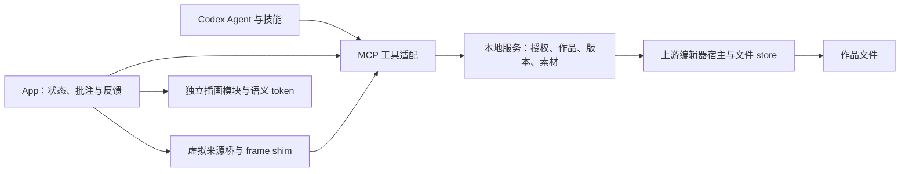

# MineDesign 架构与文件路由

本文是模块职责、依赖边界和文件地图的事实说明。Agent 入口与通用决策规则见 [AGENTS.md](AGENTS.md)；产品用途见 [CONTEXT.md](CONTEXT.md)，视觉契约见 [DESIGN.md](DESIGN.md)。命令以 package scripts 和 CLI help 为准；运行与排障见 [docs/development.md](docs/development.md)。

## 领域与依赖

MineDesign 使用 Codex 的 Agent 生成及修改作品，本地插件提供编辑器、文件服务和反馈桥。以下是现有模块的职责划分，不要求为了目录形式重写运行时。

| 领域概念 | 含义与生命周期 | 主要负责方 |
| --- | --- | --- |
| 作品 Document | 以目录和类型识别；服务生成稳定 id，打开时取得当前 grant | 文档服务；编辑器消费其记录 |
| 设计稿 Design | 多画板作品，采用 canvas.json v3、.dc.html 和 DCLogic | design 技能、上游 design runtime |
| 设计系统 Design system | 规范、tokens、组件、素材及文档的集合 | design-system 技能、上游 system runtime |
| 素材 Asset | 通过工具导入的内容寻址资源；引用返回地址 | 授权工作区、共享 store |
| 批注 Annotation | 绑定作品、目标、来源版本的持久草稿 | App 收集，服务持久化 |
| 反馈 Feedback | 用户显式提交的一轮意见及补充说明 | App 核对、保存后经宿主发给 Agent |
| grant | 当前服务进程对作品的临时访问地址 | 由服务签发；与稳定作品身份分开 |

依赖方向：技能使用公开文件协议和工具；App 通过 transport 调用服务；MCP 将输入校验与服务结果适配为宿主协议；上游 runtime 通过 host shim 读写 store。插画、图标和主题属于呈现资源，不处理业务和传输。当前 `service.mjs` 同时组织领域操作与 HTTP 基础设施；新增需求先沿用该边界，出现实际复杂度后再拆分。

## 文件地图

### 自有运行时

| 文件 | 职责与修改时机 |
| --- | --- |
| `bin/mdn.mjs` | 用户 CLI 的帮助、版本与安装命令分发；其余进入构建后的服务 |
| `src/cli.mjs` | 工作区、端口和启动模式；默认实验工作区预打开示例；管理服务退出 |
| `src/service.mjs` | 项目路径授权、作品打开、检查、素材、批注、反馈版本检查、回环 HTTP 与事件代理 |
| `src/mcp.mjs` | MCP 工具 schema、可见性、入口与 UI resource；业务规则由服务执行 |
| `src/brand.mjs` | 版本、稳定 App URI、MCP 品牌图标与选中资源元数据 |
| `src/app.html` | 外壳语义结构：顶栏、作品视窗、中央状态、反馈侧栏与批注弹窗 |
| `src/app.mjs` | 作品选择、加载状态、主题信号、批注草稿、显式发送与下载交接；不直接读磁盘 |
| `src/virtual.mjs` | 虚拟 URL、资源改写、blob URL、嵌套预览和请求分块；不决定用户作品内容 |
| `src/frame-shim.js` | 注入 srcdoc 文档，接管 fetch、事件、子 frame 与存储命名空间；由构建作为文本嵌入 |

### 视觉、构建与安装

| 文件或目录 | 职责 |
| --- | --- |
| `assets/tokens.css` | 本地基础与语义 token；宿主标准样式变量缺失时回退 |
| `assets/app.css` | 页面和外壳组件布局；不承载插画内部构图 |
| `assets/editor-theme.css` | 上游编辑器 chrome 的视觉适配；不注入用户画板配色 |
| `assets/illustrations/` | 插画统一入口、构图与样式；用途目录及替换契约见其 README |
| `assets/brand/` | Logo、favicon、状态与主题资源；references 保留来源及许可，版本目录用于 manifest 缓存隔离 |
| `scripts/build-brand-icons.mjs` | 从品牌源生成各状态和主题资源 |
| `scripts/build.mjs` | 打包 App 与服务、嵌入插画及样式、向两套已构建编辑器注入主题 |
| `scripts/install-local.mjs` | 创建本机 marketplace、生成绝对启动配置和构建指纹，再调用官方 Codex CLI 注册 |
| `.codex-plugin/plugin.json` | 插件名称、版本、能力、技能与资源入口元数据 |
| `package.json` / `package-lock.json` | scripts、依赖、workspace、打包清单及锁定版本 |
| `.gitignore` | 本地数据和生成物的入库边界；显式允许 vendor 供 CodeGraph 索引 |
| `packages/preview-react18/` | 独立 React 18 预览依赖；编辑器使用 React 19，二者保持边界 |

### 技能、作品、测试与上游

| 文件或目录 | 职责 |
| --- | --- |
| `skills/design/` | 生成与修改设计稿的方法；references 按格式、批注、印刷、组件等任务分支读取 |
| `skills/design-system/` | 创建与维护设计系统的方法；references 包含格式、提取、封面和 token 示例 |
| `examples/showcase/` / `examples/showcase-system/` | Pine 设计稿及其规范、组件、品牌素材；是作品内容，不是插件内部 UI |
| `examples/studio/` / `examples/design-system/` | Mine Studio 实验作品；可能包含用户在 GUI 的编辑，测试不用它们作写入夹具 |
| `tests/app-loading.test.mjs` | App DOM 边界：旧 grant 恢复、中央错误与重试、反馈保留；文件侧使用真实服务 |
| `tests/mcp.test.mjs` | 构建后的真实 stdio MCP、工具、资源、入口与代理契约 |
| `tests/service.test.mjs` | 文件读取、保存冲突、工作区边界、批注版本与 token 来源 |
| `tests/preview-origin.test.mjs` | Codex/HTTP/opaque origin 与窗口来源回归 |
| `tests/fixtures/` | 独立、可复制到临时工作区的测试作品；与用户编辑示例隔离 |
| `vendor/baocut/apps/` | 两套完整编辑器的启动入口和构建脚本 |
| `vendor/baocut/packages/design*` | 设计与设计系统协议、检查器、host shim 和 runtime |
| `vendor/baocut/packages/slides/` | 两套编辑器复用的文件 store、HTTP、发布、批注与宿主消息协议；不是本项目幻灯片功能承诺 |
| `vendor/baocut/packages/protocol/` | 移植所需共享类型与协议依赖 |
| `vendor/UPSTREAM.md` | 固定上游提交、本地补丁及许可边界；修改 vendor 时同步 |

### 文档与本地产物

| 文件或目录 | 所属职责 |
| --- | --- |
| `AGENTS.md` | 每次任务的入口、工程原则与条件路由；保持简短 |
| `ARCHITECTURE.md` | 本文：领域、模块边界、文件地图与运行时契约 |
| `CONTEXT.md` | 面向使用者的功能用途、场景与当前限制 |
| `PRD.md` | 首版目标与验收规格；不是当前实现状态清单 |
| `DESIGN.md` | 外壳视觉契约、token、主题与资源分工 |
| `README.md` | 产品入口、快速启动与文档导航 |
| `docs/development.md` | 构建生效、安装、恢复、测试与 CodeGraph 工作流 |
| `docs/verification.md` | 分层验证证据和未验收能力 |
| `baocut-design-source-notes.md` / `docs/research/` | 历史调研与移植证据；当前行为以代码及较新验证为准 |
| `codegraph.json` | 团队共享索引范围与查询优先级 |
| `.codegraph/` | 本地索引数据库、后台进程状态；仅其中的 `.gitignore` 入库 |
| `.mcp.json` | 本机工作区启动配置，含绝对路径；保留本地、不入库；安装脚本生成独立配置 |
| `.local/` | 批注草稿、本机 marketplace 等运行数据，不入库；删除会影响用户草稿 |
| `.claude/` | 本地 Agent 工具写入状态，不属于产品模块 |
| `dist/`、vendor 下的 `dist/` / `src/generated/` | 生成物；从来源重建，不手改；构建后按 package files 打包 |
| `output/` | 本地截图、安装包和验证材料，不入库；效果图以交付的绝对路径引用 |
| `node_modules/` | 安装依赖，不入库 |

## 运行时契约

### 打开与加载

作品目录与类型构成稳定身份，grant 只对当前服务有效。App 初次打开、切换和重试均按目录重新打开，取得当前记录后才恢复批注与加载编辑器；异步结果只应用到当前选择。这样宿主缓存旧页面时，不会继续使用上次服务的 grant。

global/thread 共用稳定资源 `ui://minedesign/editor.html`。插件安装版本与页面资源身份分离；已打开外壳和 MCP 连接是两种缓存，刷新方法见开发文档。

### 沙箱与文件保存

Codex MCP App 不直接访问回环 HTTP；外壳经 MCP App 工具代理回本地服务，将编辑器装成 srcdoc，把图片、字体、脚本与 CSS 改成受支持的 blob 资源。浏览器模式复用桥，transport 换成本地 API。

路径授权以真实路径检查工作区边界，符号链接也受约束。写入沿用 store 的 ifMatch 与 origin 校验；Codex 消息保留完整 scheme/origin、source 和 MessagePort 校验。对传输问题的修复应保留这些契约。

### 批注与反馈

批注绑定稳定作品 id 和来源版本，存放在本机 `.local/annotations/`。补充说明文本框当前没有持久化保障。用户显式发送时先 flush 编辑器，再核对版本，经宿主提交原聊天；失败保留批注。作品改变后要求核对目标；消息已发送与 Agent 已完成修改分别报告。

### 资源与主题

页面只引用插画用途名，插画模块不依赖服务；构建内嵌资源以满足 CSP。外壳消费标准宿主样式与本地 token，上游编辑器 chrome 使用适配层；作品自己的 token 和品牌独立。设计系统安装到设计稿目前是复制与引用，不承诺实时双向同步。

## 变更落点

新增工具：服务操作 → MCP schema/可见性 → 公开行为测试。新增呈现资源：资源目录 → 统一入口 → 页面引用 → 构建与实际截图。修改上游：最小补丁 → UPSTREAM 记录 → 对应协议与渲染回归。跨层变化先检查调用方、失败路径和恢复方式，再修改接口。
